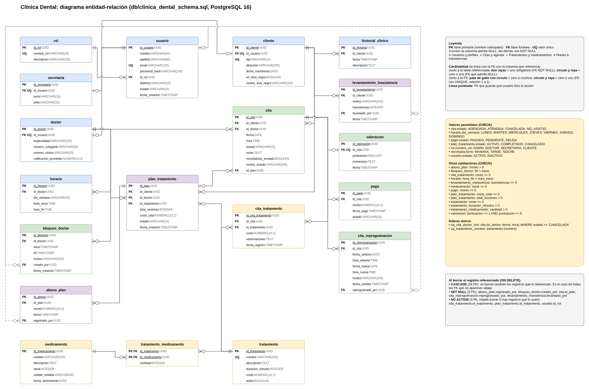
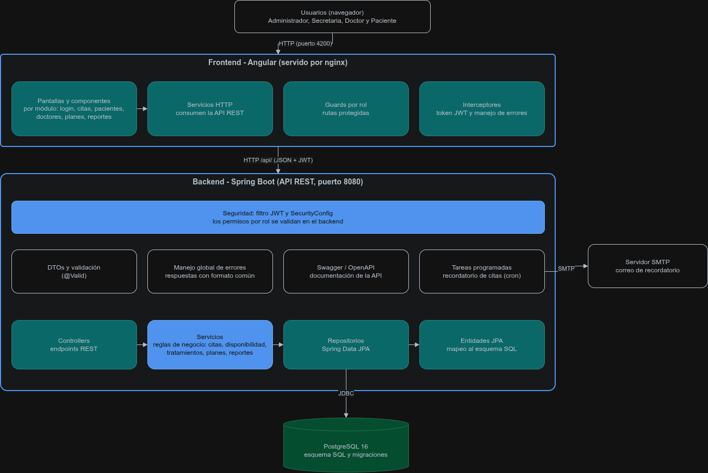
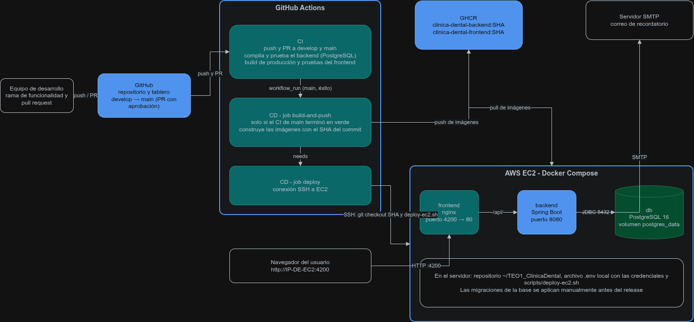
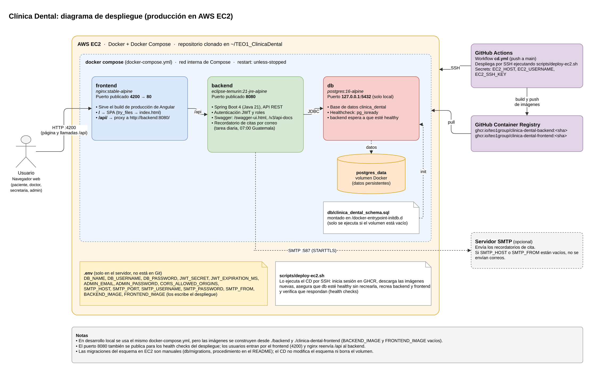
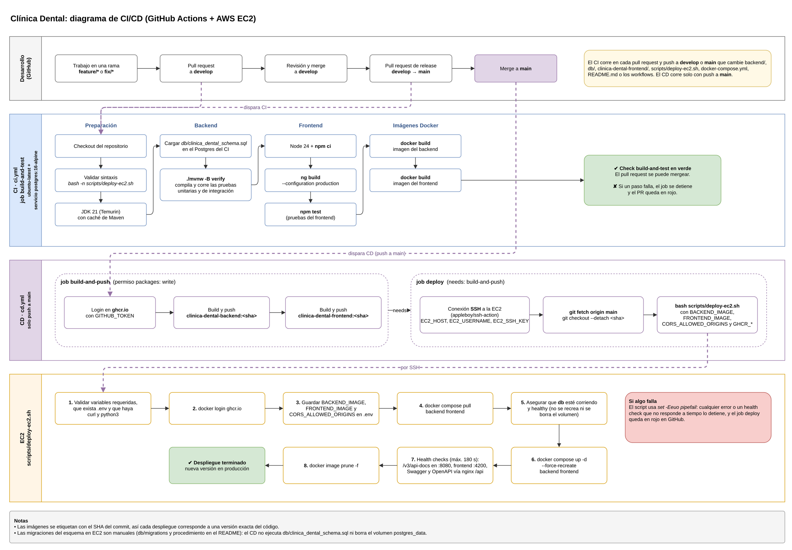
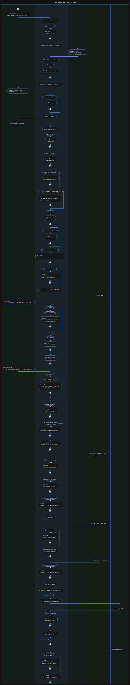

# TEO1_ClinicaDental

Sistema web para una clínica dental: registro de pacientes, doctores y horarios, agendamiento y reprogramación de citas sin solapamiento, bloqueos de doctor, control de inasistencias, tratamientos por cita y planes de tratamiento con abonos, reportes y recordatorios de citas.

## Documentación

Los documentos del proyecto están en `docs/Manuales y Documentacion/` (PDF). Los diagramas están al final de este README y en `docs/Diagramas/`.

| Documento | Qué contiene | Archivo |
|-----------|--------------|---------|
| Documento final | Propósito y alcance, requisitos funcionales, técnicos y no funcionales (con sus métricas), seguridad básica, diagramas, historial de sprints, retrospectiva y estimaciones contra tiempo real | [DocumentacionFinal_ClinicaDental.pdf](docs/Manuales%20y%20Documentacion/DocumentacionFinal_ClinicaDental.pdf) |
| Manual de usuario | Cómo usar el sistema en cada rol (paciente, doctor, secretaria y administrador), con capturas, reglas del sistema y solución de problemas | [ManualdeUsuarioClinicaDental.pdf](docs/Manuales%20y%20Documentacion/ManualdeUsuarioClinicaDental.pdf) |
| Manual técnico | Arquitectura, modelo de datos, seguridad, lógica de negocio, API, variables de entorno, Docker, CI/CD, despliegue en EC2, respaldo y solución de problemas | [ManualTecnicoClinicaDental.pdf](docs/Manuales%20y%20Documentacion/ManualTecnicoClinicaDental.pdf) |

Además: [Respaldo y restauración de la base](docs/respaldo-y-restauracion.md).

## Requisitos

| Herramienta | Versión | Dónde se define |
|-------------|---------|-----------------|
| Java (JDK) | 21 | `backend/pom.xml` (`java.version`), `ci.yml`, `backend/Dockerfile` (`eclipse-temurin:21`) |
| Spring Boot | 4.1.1 | `backend/pom.xml` (parent `spring-boot-starter-parent`) |
| springdoc-openapi | 3.1.1 | `backend/pom.xml` |
| Maven | 3.9.16 mediante el wrapper `./mvnw` (wrapper 3.3.4); no hace falta instalar Maven | `backend/.mvn/wrapper/maven-wrapper.properties` |
| Node.js | 24.15.0 | `ci.yml`, `clinica-dental-frontend/Dockerfile` (`node:24.15.0-alpine`) |
| npm | 11 (`npm@11.19.0`) | `clinica-dental-frontend/package.json` (`packageManager`) |
| Angular | 22.1 (`@angular/core` 22.1.5 en `package-lock.json`) | `clinica-dental-frontend/package.json` |
| PostgreSQL | 16 | `docker-compose.yml` y `ci.yml` (`postgres:16-alpine`) |
| Docker | Docker Engine con el plugin Compose v2 o superior (comando `docker compose`, no `docker-compose`) | `docker-compose.yml` |

Con Docker solo se necesita Docker con Compose v2 o superior y `openssl`. Sin Docker se necesitan JDK 21, Node.js 24.15.0 con npm 11 y PostgreSQL 16 con los clientes `psql` y `createdb`.

Estructura del repositorio:

- `backend/`: API REST en Spring Boot con Spring Security (JWT), JPA y PostgreSQL. El código está en `backend/src/main/java/com/teo1/clinicadental/` (`controller`, `service`, `repository`, `model`, `dto`, `security`, `config`, `exception`).
- `clinica-dental-frontend/`: aplicación Angular. Llama al backend con el prefijo `/api` (en desarrollo lo redirige `proxy.conf.json` y en Docker lo hace `nginx.conf`).
- `db/clinica_dental_schema.sql`: esquema completo para una base vacía. `db/migrations/`: cambios para bases que ya tienen datos. `db/demo/datos-demo.sql`: datos de demostración.
- `scripts/`: `deploy-ec2.sh` (lo ejecuta el CD dentro de la instancia EC2), `respaldar-db.sh` y `restaurar-db.sh` (respaldo y restauración de la base).
- `docs/`: `Manuales y Documentacion/` (PDF), `Diagramas/` (`.drawio` y `.png`) y `respaldo-y-restauracion.md`.
- `.github/workflows/`: `ci.yml` y `cd.yml`.

## Levantar con Docker

Desde la raíz del repositorio:

```bash
cp .env.example .env
openssl rand -base64 32
```

Abre `.env` y llena como mínimo:

- `DB_PASSWORD`: la contraseña que tendrá PostgreSQL.
- `JWT_SECRET`: pega la salida del comando `openssl rand -base64 32`.
- `ADMIN_EMAIL` y `ADMIN_PASSWORD`: credenciales del primer administrador (ver [Primer ingreso y cómo probarlo](#primer-ingreso-y-cómo-probarlo)).

Las variables `SMTP_*` son opcionales: si `SMTP_HOST` o `SMTP_FROM` quedan vacíos, el backend arranca igual y no envía los correos de recordatorio de citas.

```bash
docker compose up --build
```

La primera vez que se crea el volumen `postgres_data`, el contenedor `db` carga `db/clinica_dental_schema.sql` automáticamente.

- Frontend: http://localhost:4200
- Backend: http://localhost:8080
- Swagger UI directo al backend: http://localhost:8080/swagger-ui.html
- OpenAPI JSON directo al backend: http://localhost:8080/v3/api-docs
- Swagger UI a través del proxy nginx: http://localhost:4200/api/swagger-ui.html
- OpenAPI JSON a través del proxy nginx: http://localhost:4200/api/v3/api-docs

Si el puerto 5432 ya está ocupado (por ejemplo en macOS), configura solo en el `.env` local ignorado por Git `DB_HOST_PORT=5434` y `DB_URL=jdbc:postgresql://localhost:5434/clinica_dental`. El backend dentro de Docker sigue conectándose a `db:5432`; el puerto publicado por defecto continúa siendo 5432.

## Levantar sin Docker

Requiere PostgreSQL 16 escuchando en `localhost:5432`. Desde la raíz del repositorio, crea la base y carga el esquema (`psql` y `createdb` piden la contraseña del usuario `postgres`):

```bash
createdb -h localhost -U postgres clinica_dental
psql -h localhost -U postgres -d clinica_dental -v ON_ERROR_STOP=1 -f db/clinica_dental_schema.sql
```

El esquema empieza con `DROP TABLE`: úsalo solo en una base nueva o de desarrollo.

Backend, en una terminal desde la raíz del repositorio. Usa el mismo `.env` de la sección anterior (`cp .env.example .env` y llénalo si aún no existe); `DB_PASSWORD` debe ser la contraseña de tu PostgreSQL local:

```bash
set -a
. ./.env
set +a
cd backend
./mvnw spring-boot:run
```

Frontend, en otra terminal desde la raíz del repositorio:

```bash
cd clinica-dental-frontend
npm ci
npm start
```

- Frontend: http://localhost:4200 (`npm start` ejecuta `ng serve` con `proxy.conf.json`, que envía `/api` a `http://localhost:8080`)
- Swagger UI: http://localhost:8080/swagger-ui.html

Para detener cada proceso usa `Ctrl+C` y vuelve a la raíz con `cd ..`.

## Variables de entorno

El archivo `.env` contiene secretos y **no se sube a Git** (está en `.gitignore`). En el repositorio solo está `.env.example`, sin valores secretos.

| Variable | Para qué sirve | Obligatoria |
|----------|----------------|-------------|
| `DB_NAME` | Nombre de la base que crea el contenedor `db` y que usa el backend en Docker | No (por defecto `clinica_dental`) |
| `DB_USERNAME` | Usuario de PostgreSQL | No (por defecto `postgres`) |
| `DB_PASSWORD` | Contraseña de PostgreSQL | Sí |
| `DB_HOST_PORT` | Puerto del host donde Compose publica PostgreSQL (solo en `127.0.0.1`) | No (por defecto `5432`) |
| `DB_URL` | URL JDBC del backend cuando corre fuera de Docker o en las pruebas. En Docker, Compose la arma con `db:5432` | No (por defecto `jdbc:postgresql://localhost:5432/clinica_dental`) |
| `JWT_SECRET` | Clave en base64 para firmar los tokens JWT | Sí |
| `JWT_EXPIRATION_MS` | Duración del token en milisegundos | No (por defecto `86400000`, 24 horas) |
| `CORS_ALLOWED_ORIGINS` | Orígenes permitidos por CORS, separados por comas | No (por defecto `http://localhost:4200`; en EC2 lo escribe el CD) |
| `ADMIN_EMAIL` | Email del primer administrador | Sí para poder entrar la primera vez |
| `ADMIN_PASSWORD` | Contraseña del primer administrador | Sí para poder entrar la primera vez |
| `SMTP_HOST` | Servidor SMTP para los correos de recordatorio | No (vacío desactiva los correos) |
| `SMTP_PORT` | Puerto SMTP (STARTTLS) | No (por defecto `587`) |
| `SMTP_USERNAME` | Usuario SMTP | No |
| `SMTP_PASSWORD` | Contraseña SMTP | No |
| `SMTP_FROM` | Remitente de los correos | No (vacío desactiva los correos) |
| `RECORDATORIO_CRON` | Cuándo se envían los correos de recordatorio, en formato cron de Spring (segundo minuto hora día mes día-semana), en hora de `America/Guatemala`. Para una demo, cada 2 minutos: `0 */2 * * * *` | No (por defecto `0 0 7 * * *`, todos los días a las 07:00) |
| `BACKEND_IMAGE` | Imagen del backend. Vacía en local (se construye desde `./backend`); en EC2 la escribe `deploy-ec2.sh` | No |
| `FRONTEND_IMAGE` | Imagen del frontend. Vacía en local (se construye desde `./clinica-dental-frontend`); en EC2 la escribe `deploy-ec2.sh` | No |

Valores fijos en `backend/src/main/resources/application.properties` (no son variables de entorno):

| Propiedad | Valor | Uso |
|-----------|-------|-----|
| `app.zona-horaria` | `America/Guatemala` | Hora "actual" del backend para validar fechas, plazos y el cron del recordatorio |
| `app.citas.duracion-minutos` | `30` | Duración de cada cita, para el horario, los solapamientos y los bloqueos |
| `app.citas.antelacion-cancelacion-horas` | `24` | Anticipación mínima con la que el paciente puede cancelar o reprogramar su cita |
| `app.citas.max-inasistencias` | `3` | Inasistencias (No asistió) desde las cuales el paciente no puede agendar hasta que se levante la restricción |
| `app.citas.recordatorio-cron` | `${RECORDATORIO_CRON:0 0 7 * * *}` | Horario del correo de recordatorio; se cambia con la variable `RECORDATORIO_CRON` |

El correo de recordatorio avisa las citas Agendadas que empiezan en las próximas 24 horas, una sola vez por cita. La campana del frontend consulta `GET /citas/proximas`, que por defecto mira 48 horas y acepta de 1 a 72.

## Primer ingreso y cómo probarlo

El administrador inicial lo crea `AdminInitializer` al arrancar el backend, con `ADMIN_EMAIL` y `ADMIN_PASSWORD` del `.env`:

- Solo lo crea si ambas variables tienen valor y todavía no existe ningún usuario con rol ADMIN.
- Si ya existe un ADMIN no hace nada: cambiar `ADMIN_PASSWORD` después no cambia la contraseña del administrador existente.
- Si el email ya pertenece a otro usuario, no lo crea y deja un aviso en el log del backend.

En el despliegue de EC2 el administrador es `admin@clinica.com`. Su contraseña es la `ADMIN_PASSWORD` del `.env` del servidor: no se publica en el repositorio y se entrega al equipo evaluador por un canal privado.

Las contraseñas de usuarios nuevos deben tener al menos 8 caracteres, con una mayúscula, una minúscula, un número y un carácter especial. Usa la misma regla para `ADMIN_PASSWORD`.

El recorrido siguiente prueba las reglas principales. Para ver cada pantalla paso a paso, con capturas, consulta el [Manual de usuario](docs/Manuales%20y%20Documentacion/ManualdeUsuarioClinicaDental.pdf).

Prueba completa en http://localhost:4200 (o en la URL de EC2):

1. Inicia sesión con `ADMIN_EMAIL` y `ADMIN_PASSWORD`. En EC2 usa el usuario `admin@clinica.com`.
2. En **Usuarios**, crea un usuario con rol DOCTOR (la especialidad es obligatoria) y otro con rol SECRETARIA.
3. En **Doctores**, abre el doctor y agrégale un horario, por ejemplo de 08:00 a 12:00 el día de mañana. Un horario que se traslapa con otro del mismo día se rechaza.
4. Cierra sesión y registra un paciente en `/registro` (DPI de 13 dígitos). Registra un segundo paciente igual.
5. Entra como el primer paciente y ve a **Citas > Nueva Cita**: elige el doctor, mañana, a las 09:00. La cita queda Agendada. Cada cita dura 30 minutos.
6. Solapamiento: entra como el segundo paciente y pide el mismo doctor, mañana, a las 09:15. Se rechaza con "El doctor ya tiene una cita agendada en ese horario". A las 09:30 sí se acepta, porque empieza justo cuando termina la anterior.
7. Fuera de horario: pide las 11:45 (terminaría a las 12:15) o un día sin horario. Se rechaza con "La cita no cabe dentro del horario de atencion del doctor".
8. Como SECRETARIA (o ADMIN), en **Citas > Nueva Cita** se elige también el paciente.
9. Cancelar con motivo: como SECRETARIA, en **Citas**, pulsa cancelar en la cita de las 09:30 de mañana. El motivo es obligatorio: si lo dejas vacío se rechaza. Con motivo la cita queda Cancelada, el motivo aparece en la columna **Motivo** y la hora queda libre para volver a agendarla.
10. Atendida o no asistió: entra como el doctor o la secretaria; en **Citas** el doctor ve solo sus citas y la secretaria ve todas, y ambos pueden marcarlas como Atendida o No asistió. No asistió pide motivo obligatorio; en Atendida el motivo es opcional. El doctor solo puede marcarlas desde la hora de inicio de la cita; antes recibe "No puedes marcar la cita como ATENDIDA antes de su hora de inicio". La secretaria y el admin no tienen esa restricción. Solo las citas Agendadas cambian de estado; los demás estados son finales.
11. Plazo de 24 horas: como ADMIN o SECRETARIA, agrega al doctor un horario de 08:00 a 12:00 para el día que cae dentro de 3 días. Como el primer paciente, agenda una cita dentro de 3 días a las 09:00 y otra dentro de 3 días a las 11:00; cancela la de las 11:00 con un motivo y se acepta, porque falta más de 24 horas. Si faltan menos de 24 horas para su cita de mañana a las 09:00 (por ejemplo, si ya pasaron las 09:00 de hoy), al cancelarla recibe "Solo puedes cancelar tu cita con al menos 24 horas de anticipacion". La secretaria sí puede cancelar esa misma cita.
12. Reprogramar: como el primer paciente, reprograma su cita de dentro de 3 días de las 09:00 a las 10:00 con un motivo. La cita queda en la nueva hora y la de las 09:00 queda libre. Casos que se rechazan: sin motivo; la misma fecha y hora ("La nueva fecha y hora son iguales a las actuales"); una hora ocupada por otra cita del doctor; una hora fuera del horario; una fecha ya pasada; y, como paciente, una cita a la que le faltan menos de 24 horas ("Solo puedes reprogramar tu cita con al menos 24 horas de anticipacion"). El doctor no ve el botón de reprogramar.
13. Bloqueo de doctor: como SECRETARIA (o ADMIN), en **Doctores**, abre el doctor y en **Bloqueos** crea uno para dentro de 3 días de 08:00 a 10:00 con un motivo. Se acepta aunque la cita reprogramada empiece a las 10:00, porque los bordes no se cruzan. Como el segundo paciente, intenta agendar ese día a las 08:30 o a las 09:30: se rechaza con "El doctor no atiende en ese horario: <motivo>"; reprogramar una cita a esa franja también se rechaza. Intenta crear otro bloqueo de 09:30 a 10:30 ese mismo día: se rechaza porque el doctor tiene una cita agendada en ese periodo y primero hay que reprogramarla o cancelarla. Al eliminar el bloqueo, la franja vuelve a poder agendarse. El doctor ve sus propios bloqueos pero no puede crearlos ni borrarlos; el paciente no ve el listado completo (solo los bloqueos vigentes, para el aviso al agendar).
14. Tratamientos en el historial: solo se registran en citas **Atendidas**, y la API no deja crear citas con fecha u hora pasada. Para tener una cita atendida: carga los [datos de demo](#datos-de-demo), que ya traen citas atendidas de ayer y de hoy con tratamientos; o marca una cita Agendada como Atendida siendo SECRETARIA o ADMIN, que no tienen restricción de hora; o espera a que llegue su hora de inicio y márcala como su doctor. Luego, como el doctor de esa cita, entra a **Pacientes**, abre el historial del paciente y en **Registrar tratamiento** elige la cita atendida y un tratamiento del catálogo. Si dejas vacío el costo se usa el precio del catálogo; puedes escribir otro costo y observaciones. La tabla **Tratamientos realizados** muestra cada tratamiento con su costo y el **Total**. Registrar en una cita que no está Atendida devuelve 409, y otro doctor recibe 403. La secretaria y el admin ven los tratamientos y el total, pero no los registran.
15. Reportes: como ADMIN o SECRETARIA, abre **Reportes**, elige el reporte (citas por doctor y estado, inasistencias y cancelaciones, ingresos por tratamiento, horas más demandadas o ganancias) y pulsa **Generar reporte**. Por defecto toma el mes actual. En citas por doctor aparece una fila por doctor activo con sus citas Agendadas, Atendidas, Canceladas, No asistió y el total del periodo, contando ambas fechas extremas. Los reportes no cuentan las citas cuya hora de inicio todavía no llega. Si la fecha inicial es posterior a la final se rechaza. DOCTOR y CLIENTE no ven la opción.
16. Inasistencias: el límite es 3 inasistencias (`app.citas.max-inasistencias`). Con los [datos de demo](#datos-de-demo), Luis Pérez tiene 2 y Carmen Díaz tiene 3 y está bloqueada. Como el doctor o la secretaria, marca No asistió una cita de Luis Pérez: llega a 3 y ya no puede agendar (409, también al agendar sesiones de un plan). En la ficha del paciente, la tarjeta **Inasistencias** muestra el conteo y el estado. Como ADMIN o SECRETARIA, pulsa **Levantar restricción**, escribe el motivo (obligatorio, máximo 200 caracteres) y confirma: el conteo vuelve a cero y queda registrado quién, cuándo y por qué. Levantar la restricción de un paciente que no está bloqueado se rechaza.
17. Planes y abonos: en **Planes de tratamiento** pulsa **Nuevo plan** como DOCTOR (el plan queda a su nombre), SECRETARIA o ADMIN (eligen el doctor); elige el paciente, el tratamiento y el total de sesiones (de 1 a 50). Si dejas vacío el costo total se usa el costo del catálogo por el número de sesiones. En **Ver detalle**, como SECRETARIA o ADMIN, **Agendar sesión** crea la cita de la sesión con las mismas validaciones de horario, bloqueos, solapamiento e inasistencias, y **Registrar abono** acepta un monto mayor a cero que no supere el saldo (de lo contrario se rechaza). El avance es sesiones atendidas sobre sesiones totales y el plan pasa a Completado cuando todas se atienden. El doctor solo consulta los abonos.
18. Catálogo de tratamientos: como ADMIN, en **Tratamientos**, pulsa **Nuevo Tratamiento** (nombre único, duración, costo no negativo) o edita uno existente. Un tratamiento inactivo deja de ofrecerse para nuevos registros pero se conserva en los anteriores, y cambiar un costo no altera lo ya cobrado.
19. Paciente: **Mis Tratamientos** y **Mis Planes** muestran, en solo lectura, sus tratamientos con el total y sus planes con avance, abonos y saldo.
20. Campana de recordatorios: como paciente o como doctor, la campana del encabezado muestra las citas Agendadas de las próximas 48 horas y, al iniciar sesión, aparece un aviso con cuántas hay. La campana se actualiza al iniciar sesión, al recargar la página y después de cambiar el estado o reprogramar una cita. ADMIN y SECRETARIA no ven la campana ni reciben recordatorios.
21. Swagger: abre la URL de Swagger UI, ejecuta `POST /auth/login`, copia el valor de `token`, pulsa **Authorize** y pégalo (solo el token, sin la palabra `Bearer`). Después prueba, por ejemplo, `GET /citas/proximas`, `GET /tratamientos` o `GET /reportes/citas-por-doctor` con `desde` y `hasta` en formato `yyyy-MM-dd`.

## Datos de demo

`db/demo/datos-demo.sql` llena una base con datos de prueba para la demo y también sirve para reiniciarla: cada corrida borra la demo anterior y la vuelve a cargar. Necesita una base que ya tenga `db/clinica_dental_schema.sql` o las migraciones aplicadas hasta `2026-10-sprint6-*.sql`, incluido el catálogo de tratamientos (el script busca los tratamientos por nombre). Las fechas y horas se calculan al correrlo, con la hora de `America/Guatemala`, así que conviene cargarlo justo antes de la demo.

Qué crea (todos los ids empiezan con `de000000-`):

- 2 doctores: Lucía Morales (Odontología general, horario de 08:00 a 18:00) y Andrés Castillo (Ortodoncia, de 09:00 a 17:00), con horario todos los días de la semana.
- 1 secretaria: Sofía Herrera. No crea ADMIN: para los pasos de administrador se usa el que crea `ADMIN_EMAIL`.
- 5 pacientes: Ana López, Luis Pérez, María Gómez, Jorge Ruiz (en lista negra) y Carmen Díaz.
- Citas en curso: dos citas Agendadas que empezaron entre 20 y 50 minutos antes de correr el script, así el doctor las puede marcar a cualquier hora del día. La de Ana López con la Dra. Morales sirve para atenderla y registrar el tratamiento. La de Luis Pérez con el Dr. Castillo sirve para marcar No asistió.
- Citas pasadas atendidas con tratamientos (ayer, una hora antes de las citas en curso y en las últimas semanas), No asistió y Canceladas con motivo, y Agendadas para mañana y pasado mañana.
- Inasistencias: Luis Pérez tiene 2 desde que le levantaron la restricción hace 40 días, a una del límite de 3. Carmen Díaz tiene 3 y está bloqueada para agendar.
- Planes con abonos y sesiones futuras: Ana López, endodoncia de 3 sesiones (2 atendidas, la tercera pasado mañana, saldo Q2,000), y María Gómez, ortodoncia de 6 sesiones (2 atendidas, 1 cancelada, su cita de mañana y saldo Q1,200).
- Una reprogramación, dos registros de historial clínico y un bloqueo del Dr. Castillo pasado mañana de 08:00 a 13:00.

Los correos de los usuarios terminan en `@clinica-demo.test`. Al terminar, el script imprime los correos y roles, las dos citas en curso, las inasistencias por paciente y el saldo de los planes.

Recorrido sugerido con estos datos:

1. Secretaria: registrar un paciente nuevo y agendarle una cita.
2. Dra. Morales: marcar Atendida la cita en curso de Ana López y registrar un tratamiento.
3. Dr. Castillo: marcar No asistió la cita en curso de Luis Pérez. Con eso llega a 3 inasistencias y, si la secretaria intenta agendarle, recibe el aviso de bloqueo.
4. Secretaria: levantar la restricción de Carmen Díaz, registrar un abono en el plan de María Gómez y agendar una sesión del plan.
5. Secretaria o administrador: reportes de inasistencias, ingresos por tratamiento, horas demandadas, ganancias y citas por doctor de los últimos 60 días.
6. Ana López: Mis planes y Mis tratamientos. La contraseña no está en el repositorio: se pasa al ejecutar con la variable `clave_demo`, se guarda cifrada con BCrypt y es la misma para todos los usuarios de demo. Usa una contraseña que cumpla la regla de la sección anterior. Con la variable opcional `correo_demo` se reemplaza el correo de Ana López para recibir en un buzón real el recordatorio de su cita de mañana.

Con Docker, desde la raíz del repositorio (la contraseña se pide sin mostrarla y no queda en el historial del shell):

```bash
read -rsp 'Contraseña de demo: ' CLAVE_DEMO; echo
docker compose exec -T -e CLAVE_DEMO="$CLAVE_DEMO" db sh -lc \
  'psql -U "$POSTGRES_USER" -d "$POSTGRES_DB" -v ON_ERROR_STOP=1 -v clave_demo="$CLAVE_DEMO"' \
  < db/demo/datos-demo.sql
unset CLAVE_DEMO
```

Para usar `correo_demo`, agrega `-v correo_demo='<tu correo>'` dentro del comando `psql`.

Para quitar la demo sin volver a cargarla (no pide contraseña):

```bash
docker compose exec -T db sh -lc \
  'psql -U "$POSTGRES_USER" -d "$POSTGRES_DB" -v ON_ERROR_STOP=1 -v solo_limpiar=1' \
  < db/demo/datos-demo.sql
```

### Demo en EC2

En EC2 la base es la de producción. Agrega usuarios y citas ficticios que aparecen en los listados y en los reportes, así que córrelo solo con autorización del equipo. El script que se usa es el del commit desplegado.

1. Entra por SSH y ve al repositorio: `cd ~/TEO1_ClinicaDental`. Revisa con `git log --oneline -1` que sea el commit desplegado.
2. Respalda la base antes de cargar la demo por primera vez: `scripts/respaldar-db.sh` (ver [Respaldo y restauración](docs/respaldo-y-restauracion.md)).
3. Carga la demo con el comando de Docker de arriba, desde `~/TEO1_ClinicaDental`.
4. Para repetir el recorrido, vuelve a correr el mismo comando justo antes de empezar: deja la demo como nueva y recalcula las citas en curso.
5. Al terminar la presentación, quita la demo con `solo_limpiar=1`.

Advertencias:

- Se puede correr varias veces: primero borra los 8 usuarios de demo por su id y, en cascada, sus perfiles, horarios, citas, tratamientos de cita, reprogramaciones, historial, bloqueos, planes, abonos y levantamientos. No toca otros datos.
- Lo que se crea durante la demo con ids que no son de demo no se borra. Por ejemplo, un paciente registrado en el recorrido sigue existiendo, aunque sus citas con doctores de demo sí se borran. Para repetir el registro, usa otro correo y otro DPI.
- Falla si en la base ya existe, con otro id, alguno de sus correos o DPI. Toda la carga va en una transacción: si algo falla no queda nada a medias.
- Si el catálogo de tratamientos no tiene los nombres esperados, las citas atendidas quedan sin tratamientos.

## Roles y permisos

Según `SecurityConfig` y los servicios (`CitaService`, `ReprogramacionCitaService`, `BloqueoDoctorService`, `InasistenciaService`, `TratamientoService`, `PlanTratamientoService` y `ReporteCitaService`):

| Acción | ADMIN | SECRETARIA | DOCTOR | CLIENTE |
|--------|-------|------------|--------|---------|
| Registrarse en `/registro` | - | - | - | Sí (público) |
| Crear, editar y activar o desactivar usuarios del personal; ver roles | Sí | No | No | No |
| Ver pacientes y su detalle | Sí | Sí | Sí | No |
| Crear, editar y desactivar pacientes | Sí | Sí | No | No |
| Lista negra de pacientes | No | Sí | No | No |
| Ver historial clínico | Sí | Sí | Sí | No |
| Agregar al historial clínico | Sí | No | Sí | No |
| Ver doctores y sus horarios | Sí | Sí | Sí | Sí |
| Editar y desactivar doctores | Sí | No | No | No |
| Crear, editar y eliminar horarios | Sí | Sí | Solo los suyos | No |
| Agendar citas | Sí, eligiendo paciente | Sí, eligiendo paciente | No | Sí, solo para sí mismo |
| Ver citas | Todas | Todas | Solo las suyas | Solo las suyas |
| Cancelar una cita (motivo obligatorio) | Cualquiera, sin plazo | Cualquiera, sin plazo | No | Solo las suyas, con al menos 24 h de anticipación |
| Marcar Atendida (motivo opcional) o No asistió (motivo obligatorio) | Cualquiera, a cualquier hora | Cualquiera, a cualquier hora | Solo las suyas, desde la hora de inicio | No |
| Reprogramar una cita (motivo obligatorio) | Cualquiera, sin plazo | Cualquiera, sin plazo | No | Solo las suyas, con al menos 24 h de anticipación |
| Crear y eliminar bloqueos de un doctor | Sí | Sí | No | No |
| Ver los bloqueos de un doctor | Todos | Todos | Solo los suyos | No |
| Ver los bloqueos vigentes de un doctor (aviso al agendar) | Sí | Sí | Sí | Sí |
| Ver el catálogo de tratamientos | Sí | Sí | Sí | No |
| Crear, editar y activar o desactivar tratamientos del catálogo | Sí | No | No | No |
| Registrar tratamientos en una cita Atendida | No | No | Solo en sus citas | No |
| Ver los tratamientos de una cita | Sí | Sí | Solo de sus citas | No |
| Ver los tratamientos y el total de un paciente (historial) | Sí | Sí | Sí | No |
| Ver sus propios tratamientos (`GET /mis-tratamientos`) | No | No | No | Sí |
| Consultar las inasistencias de un paciente | Sí | Sí | Sí | No |
| Levantar la restricción por inasistencias (motivo obligatorio) | Sí | Sí | No | No |
| Crear un plan de tratamiento | Sí, eligiendo doctor | Sí, eligiendo doctor | Solo para sí mismo | No |
| Ver planes, su avance, saldo y abonos | Todos | Todos | Solo los suyos | No |
| Agendar sesiones de un plan y registrar abonos | Sí | Sí | No | No |
| Ver sus propios planes (`GET /mis-planes`) | No | No | No | Sí |
| Reportes (citas por doctor, inasistencias y cancelaciones, ingresos por tratamiento, horas más demandadas y ganancias) | Sí | Sí | No | No |
| Recordatorios en la campana y aviso al ingresar (`GET /citas/proximas`) | No | No | Sus citas de las próximas 48 h | Sus citas de las próximas 48 h |
| Correo de recordatorio | No lo recibe | No lo recibe | No lo recibe | Lo recibe el paciente de la cita |
| Consultar la versión desplegada (`GET /version`) | Público | Público | Público | Público |

Una cita solo puede cambiar de estado mientras está Agendada. Al agendar también se valida que el doctor y el paciente estén activos, que el paciente no esté en lista negra ni haya llegado al límite de inasistencias, y que la fecha y hora sean futuras. Una cita cancelada libera su horario.

El token se valida en cada petición; si un usuario se desactiva, su token deja de servir al momento.

## Reglas de negocio (Sprints 5 y 6)

Son los valores acordados por el equipo para el Product Owner. Los plazos se calculan con la hora de `America/Guatemala` (`app.zona-horaria`).

- **Plazo para cancelar y reprogramar:** el paciente (CLIENTE) solo puede cancelar o reprogramar su cita si faltan al menos 24 horas para su inicio; con exactamente 24 horas se acepta. El valor sale de `app.citas.antelacion-cancelacion-horas=24`. SECRETARIA y ADMIN quedan exentos. Fuera de plazo la API responde 409.
- **Motivo:** obligatorio al cancelar (CANCELADA), al marcar No asistió (NO_ASISTIO) y al reprogramar; opcional al marcar Atendida. Máximo 200 caracteres. Se recortan los espacios y, si queda vacío en Atendida, no se guarda. El motivo del último cambio de estado se guarda en la cita (`motivo_estado`) y se devuelve como `motivo` en las citas.
- **Hora de inicio para el doctor:** el DOCTOR no puede marcar su cita como Atendida ni No asistió antes de la hora de inicio (409). SECRETARIA y ADMIN pueden marcarla a cualquier hora.
- **Bloqueos de doctor** (`/doctores/{idDoctor}/bloqueos`): periodos con inicio y fin (fecha y hora de Guatemala) y motivo obligatorio de hasta 200 caracteres; el inicio debe ser anterior al fin. Los crean y eliminan ADMIN y SECRETARIA; los listan ADMIN, SECRETARIA y el propio doctor. No se puede crear un bloqueo si el doctor tiene citas Agendadas que se cruzan con el periodo (409): primero hay que reprogramarlas o cancelarlas. Mientras exista el bloqueo no se puede agendar ni reprogramar una cita que se cruce con él (409 con el motivo del bloqueo). Los bordes no cuentan como cruce: una cita que termina justo cuando empieza el bloqueo, o que empieza justo cuando termina, se acepta. `GET /doctores/{idDoctor}/bloqueos-vigentes` lo puede consultar cualquier usuario autenticado y devuelve inicio, fin y motivo de los bloqueos que aún no terminan, para avisar antes de agendar.
- **Reprogramar** (`PATCH /citas/{id}/reprogramar`): solo citas Agendadas y con una fecha u hora distinta a la actual. La nueva fecha y hora se revalidan igual que al agendar: debe ser futura, caber en el horario de atención, no caer en un bloqueo y no solaparse con otra cita del doctor. Cada reprogramación queda registrada en `cita_reprogramacion` con la fecha y hora anterior y nueva, el motivo, el momento del cambio y el usuario que la hizo. La cita vuelve a quedar pendiente de recordatorio (`recordatorio_enviado` en falso), así que el paciente recibe el correo otra vez para la nueva hora.
- **Inasistencias** (`/pacientes/{id}/inasistencias`): se cuentan las citas No asistió del paciente desde su último levantamiento. Con `app.citas.max-inasistencias` (3) o más, el paciente no puede agendar una cita ni una sesión de un plan (409). ADMIN y SECRETARIA levantan la restricción con un motivo obligatorio de hasta 200 caracteres (`POST /pacientes/{id}/inasistencias/levantamientos`); queda registrado en `levantamiento_inasistencia` quién lo hizo, cuándo, el motivo y la cantidad de inasistencias, y el conteo vuelve a empezar de cero. Levantar la restricción de un paciente que no está restringido responde 409.
- **Catálogo de tratamientos** (`/tratamientos`): solo ADMIN crea y modifica tratamientos. El nombre es único, el costo no puede ser negativo y un tratamiento se desactiva (columna `activo`) en lugar de borrarse; uno inactivo no se ofrece para nuevos registros, pero se conserva en los anteriores.
- **Tratamientos en una cita** (`POST /citas/{idCita}/tratamientos`): solo los registra el DOCTOR de la cita y solo si la cita está Atendida (409 en otro estado, 403 para otro usuario). El tratamiento se elige del catálogo (activo); si no se envía `costo` se usa el costo del catálogo, y si se envía no puede ser negativo (hasta 8 enteros y 2 decimales). El costo queda copiado en el registro, así que un cambio de precio posterior no altera lo ya cobrado. Las observaciones admiten hasta 1000 caracteres. Una cita puede tener el mismo tratamiento más de una vez. El historial del paciente (`GET /pacientes/{idCliente}/tratamientos`) muestra cada tratamiento con la fecha y hora de la cita, el doctor, el costo cobrado y las observaciones, y el total de todos ellos. El paciente consulta los suyos con `GET /mis-tratamientos`.
- **Planes de tratamiento** (`/planes`): un plan tiene paciente, doctor, tratamiento, de 1 a 50 sesiones y un costo total; si no se envía, se calcula como el costo del catálogo por el número de sesiones. Lo crean ADMIN, SECRETARIA (eligen el doctor) y DOCTOR (solo para sí mismo). Cada sesión es una cita vinculada al plan que se agenda con `POST /planes/{id}/citas` (ADMIN y SECRETARIA) y pasa por las mismas validaciones que cualquier cita (horario, bloqueos, solapamiento, lista negra e inasistencias). Una sesión ocupa lugar mientras su cita está Agendada o Atendida; si se cancela o no asiste, se puede agendar otra. El avance es sesiones atendidas sobre sesiones totales y el plan se informa Completado cuando todas se atienden. El paciente consulta los suyos con `GET /mis-planes`.
- **Abonos** (`POST /planes/{id}/abonos`): los registran ADMIN y SECRETARIA; el monto debe ser mayor a cero y no puede superar el saldo, que es el costo total menos los abonos (409). Se registran con el plan bloqueado, para que dos abonos simultáneos no superen el saldo.
- **Reportes** (`/reportes`): `citas-por-doctor`, `inasistencias`, `ingresos-por-tratamiento`, `horas-demandadas` y `ganancias`, con los parámetros obligatorios `desde` y `hasta` en formato `yyyy-MM-dd`. El rango incluye ambos extremos y `desde` no puede ser posterior a `hasta` (400). Los ven ADMIN y SECRETARIA. Se calculan con consultas agregadas en la base de datos y ninguno cuenta citas cuya hora de inicio todavía no llega. `citas-por-doctor` cuenta las citas por estado de cada doctor activo, con ceros si no tiene citas en el periodo, ordenados por apellido y nombre. `ganancias` suma el costo cobrado de los tratamientos de citas Atendidas por doctor y muestra aparte el total de abonos, sin sumarlo a los tratamientos.
- **Versión** (`GET /version`): endpoint público que devuelve el commit y la fecha de construcción de la versión desplegada. Solo responde en una versión que incluya este endpoint.

## API (Swagger)

Swagger/OpenAPI es la fuente principal y actualizada de documentación de la API. Las 56 operaciones de los controllers tienen `@Operation`, con sus reglas, permisos, errores y ejemplos generados desde las anotaciones y DTO del backend. La prueba `OpenApiDocumentationIntegrationTests` comprueba que cada operación tenga resumen, descripción, respuestas y seguridad.

| Grupo (`@Tag`) | Endpoints | Rutas |
|----------------|-----------|-------|
| Autenticación | 3 | `/auth/registro`, `/auth/login`, `/auth/me` |
| Usuarios | 5 | `/admin/usuarios`, `/admin/usuarios/{id}`, `/admin/usuarios/{id}/estado`, `/roles` |
| Clientes | 8 | `/pacientes`, `/pacientes/{id}`, `/pacientes/{id}/lista-negra`, `/pacientes/{id}/historial` |
| Doctores | 8 | `/doctores`, `/doctores/{id}`, `/doctores/{id}/horarios`, `/doctores/{id}/horarios/{idHorario}` |
| Bloqueos de doctor | 4 | `/doctores/{idDoctor}/bloqueos`, `/doctores/{idDoctor}/bloqueos/{idBloqueo}`, `/doctores/{idDoctor}/bloqueos-vigentes` |
| Citas | 6 | `/citas`, `/citas/proximas`, `/citas/{id}`, `/citas/{id}/estado`, `/citas/{id}/reprogramar` |
| Tratamientos | 7 | `/tratamientos`, `/tratamientos/{id}`, `/citas/{idCita}/tratamientos`, `/pacientes/{idCliente}/tratamientos`, `/mis-tratamientos` |
| Inasistencias | 2 | `/pacientes/{id}/inasistencias`, `/pacientes/{id}/inasistencias/levantamientos` |
| Planes de tratamiento | 7 | `/planes`, `/planes/{id}`, `/planes/{id}/citas`, `/planes/{id}/abonos`, `/mis-planes` |
| Reportes | 5 | `/reportes/citas-por-doctor`, `/reportes/horas-demandadas`, `/reportes/inasistencias`, `/reportes/ingresos-por-tratamiento`, `/reportes/ganancias` |
| Versión | 1 | `/version` |

- Local: http://localhost:8080/swagger-ui.html (directo al backend) o http://localhost:4200/api/swagger-ui.html (a través de nginx en Docker).
- EC2: http://18.226.37.148:4200/api/swagger-ui/index.html y el JSON en http://18.226.37.148:4200/api/v3/api-docs.

Para probar operaciones protegidas: ejecuta `POST /auth/login`, copia el `token` de la respuesta, pulsa **Authorize** (esquema `bearerAuth`) y pega solo el token.

## Pruebas

Las pruebas de integración del backend necesitan PostgreSQL con el esquema cargado. Con Compose, inicia la base de datos y exporta las variables de `.env` antes de ejecutar Maven (Maven no carga `.env` por sí solo). Desde la raíz del repositorio:

```bash
docker compose up -d db
set -a
. ./.env
set +a
cd backend
./mvnw verify
cd ..
```

Si el volumen `postgres_data` se creó con un esquema anterior, aplica antes las migraciones de `db/migrations/`. La mayoría de las pruebas de integración se revierten al terminar; `CitasConcurrencyIntegrationTests` y `AbonosConcurrencyIntegrationTests` guardan datos reales y los borran al final, así que usa una base de desarrollo, nunca la de producción.

Las reglas de los sprints 5 y 6 tienen casos de éxito y de rechazo, entre otras, en `TratamientosIntegrationTests`, `TratamientoServiceTests`, `ReprogramarCitaIntegrationTests`, `ReprogramacionCitaServiceTests`, `BloqueosDoctorIntegrationTests`, `BloqueoDoctorServiceTests`, `ReporteCitasIntegrationTests`, `ReporteCitaServiceTests`, `PlanesTratamientoIntegrationTests`, `SeguridadSprint5IntegrationTests`, `SeguridadSprint6IntegrationTests`, `CitaServiceTests` (motivo y plazo de 24 horas), `DisponibilidadCitaServiceTests` y `FlujoCompletoIntegrationTests` (recorre el flujo completo con los roles del personal). `OpenApiDocumentationIntegrationTests` falla si una operación queda sin documentar en Swagger. El CI las ejecuta todas con `./mvnw -B verify`. En la medición del 29 de octubre de 2026 corrieron 289 pruebas sin fallas, con 93.1 % de cobertura de líneas (ver el Documento final, sección 6.1).

Frontend, desde la raíz del repositorio (son los mismos comandos del CI):

```bash
cd clinica-dental-frontend
npm ci
npm test -- --no-watch --no-progress
npm run build -- --configuration production
cd ..
```

## CI/CD y despliegue en EC2

- `ci.yml` corre en cada push y pull request hacia `main` o `develop` que modifique `backend/**`, `db/**`, `clinica-dental-frontend/**`, `scripts/deploy-ec2.sh`, `docker-compose.yml`, `README.md`, `ci.yml` o `cd.yml`. Levanta PostgreSQL 16, carga `db/clinica_dental_schema.sql`, ejecuta `./mvnw -B verify` sin SMTP, compila el frontend en producción, ejecuta sus pruebas y construye las dos imágenes Docker.
- `cd.yml` espera `workflow_run: completed` del workflow `CI`. Solo acepta conclusión `success`, evento original `push`, rama `main` y repositorio de origen igual a este repositorio. Un CI fallido, cancelado, omitido, de un PR o de `develop` no habilita el despliegue. Construye y publica las imágenes en GHCR y ejecuta `scripts/deploy-ec2.sh` por SSH (secrets `EC2_HOST`, `EC2_USERNAME`, `EC2_SSH_KEY`), siempre usando `workflow_run.head_sha` para checkout, etiquetas y despliegue. También puede ejecutarse tras cambios de README o CI que activen CI en `main`.

Las ejecuciones de CD comparten un grupo de concurrencia y no interrumpen un despliegue activo. Antes de construir y otra vez en EC2 se compara el SHA validado con la punta de `main`; una ejecución antigua falla antes de desplegar. El script verifica además que el checkout corresponda a ese SHA.

`deploy-ec2.sh` valida las variables y el `.env`, inicia sesión en GHCR, escribe `BACKEND_IMAGE`, `FRONTEND_IMAGE` y `CORS_ALLOWED_ORIGINS` en `.env`, descarga las imágenes y espera a que la base esté sana.
Después recrea solo backend y frontend y espera hasta 180 segundos a que respondan `/v3/api-docs`, el frontend, Swagger UI y OpenAPI a través de nginx; si alguno no responde, el despliegue falla.

El CD no aplica migraciones de base de datos: se hacen a mano, antes de desplegar, siguiendo [Migraciones manuales de esquema](#migraciones-manuales-de-esquema).

Protección de ramas en GitHub (iguales en `main` y `develop`): los cambios entran solo por pull request con 1 aprobación, un push nuevo descarta la aprobación anterior, las conversaciones del PR deben estar resueltas y no se permite el push forzado ni borrar la rama. No hay checks de estado obligatorios: el CI corre en cada pull request, pero GitHub no impide fusionar si falla, y las reglas no aplican a los administradores del repositorio. Lo que sí es automático es que el CD solo despliega después de un CI exitoso en `main`.

### Secrets exclusivos de CI y activación del flujo

El CI necesita estos **repository secrets**, que se configuran en **Settings > Secrets and variables > Actions > New repository secret**:

| Secret | Requisito |
|--------|-----------|
| `CI_DB_PASSWORD` | Contraseña aleatoria, no vacía y exclusiva del PostgreSQL temporal de CI. La misma referencia se usa en el servicio, `PGPASSWORD` y Maven. |
| `CI_JWT_SECRET` | Clave aleatoria en base64 que decodifique a al menos 32 bytes para HS256. Generarla y guardarla localmente por un canal privado. |

No reutilices secretos de EC2/producción ni los copies a archivos versionados, PR o logs. Estos secretos no se crean solos: los configura a mano quien administra el repositorio. Si falta `CI_DB_PASSWORD`, PostgreSQL rechazará el arranque del servicio antes de ejecutar los pasos; si falta `CI_JWT_SECRET`, el paso de validación fallará antes de Maven. Un valor JWT con formato o longitud incorrectos hará fallar el backend. Los PR desde forks no reciben estos secretos de repositorio y no podrán completar este CI; no se usa `pull_request_target` para ejecutar su código con secretos.

El encadenamiento `workflow_run` solo está activo cuando `cd.yml` existe en la rama predeterminada (`main`), según [GitHub Actions](https://docs.github.com/en/actions/reference/workflows-and-actions/events-that-trigger-workflows#workflow_run). Para comprobar el flujo con autorización conviene verificar un CI fallido (sin build ni despliegue), uno exitoso para el mismo SHA y un reintento antiguo rechazado. El CD no aplica migraciones: deben aplicarse antes de integrar en `main` (ver la sección siguiente).

Despliegue actual (se sirve por HTTP, sin TLS):

- Frontend: http://18.226.37.148:4200
- Swagger UI: http://18.226.37.148:4200/api/swagger-ui/index.html
- OpenAPI JSON: http://18.226.37.148:4200/api/v3/api-docs

### Migraciones manuales de esquema

Las migraciones se aplican manualmente y por separado del despliegue de aplicaciones. El workflow de CD no modifica el esquema de PostgreSQL ni elimina el volumen `postgres_data`.

> **No ejecutes `db/clinica_dental_schema.sql` sobre EC2 ni sobre una base con datos.** Ese archivo contiene instrucciones `DROP TABLE` y es solo para inicializar una base vacía.

Las migraciones se aplican en este orden, cada una una sola vez por base aunque todas se pueden repetir sin error:

| Orden | Archivo | Qué hace |
|-------|---------|----------|
| 1 | `db/migrations/2026-10-sprint4-cita.sql` | Estados de la cita, `recordatorio_enviado` y el índice parcial `uq_cita_doctor_slot` |
| 2 | `db/migrations/2026-10-sprint5.sql` | `motivo_estado` en `cita`, la tabla `bloqueo_doctor`, la nueva forma de `cita_tratamiento` (id propio, costo, observaciones y fecha), motivo obligatorio y `reprogramado_por` en `cita_reprogramacion`, el índice único `uq_tratamiento_nombre` y el catálogo inicial de tratamientos si la tabla está vacía. Va después de la del Sprint 4 |
| 3 | `db/migrations/2026-10-sprint6-tratamientos.sql` | Agrega `tratamiento.activo` y amplía el catálogo a 20 tratamientos, conservando los nombres, precios y estados existentes |
| 4 | `db/migrations/2026-10-sprint6-planes.sql` | Crea `plan_tratamiento` y `abono_plan` y agrega `cita.id_plan` |
| 5 | `db/migrations/2026-10-sprint6-inasistencias.sql` | Crea `levantamiento_inasistencia` |

El backend usa `ddl-auto=validate`: si se despliega una versión sobre una base sin su migración, el backend no arranca. Los pasos siguientes describen la migración del Sprint 4; la del Sprint 5 usa el mismo respaldo y luego sigue [Migración del Sprint 5](#migración-del-sprint-5), y las del Sprint 6 siguen [Migraciones del Sprint 6](#migraciones-del-sprint-6).

Realiza los pasos siguientes desde `~/TEO1_ClinicaDental` en el servidor, con acceso autorizado a la base. No actives `set -x` ni incluyas contraseñas en los comandos.

1. **Inspecciona antes de cambiar.** Confirma que `docker compose ps db` muestra la base esperada como activa. Abre una sesión `psql` para revisar `\d+ cita` y los estados existentes:

   ```bash
   docker compose exec -it db sh -lc 'psql -U "$POSTGRES_USER" -d "$POSTGRES_DB"'
   ```

   Antes de crear el índice parcial, busca horarios activos duplicados:

   ```sql
   SELECT id_doctor, fecha, hora, count(*)
   FROM cita
   WHERE estado <> 'CANCELADA'
   GROUP BY id_doctor, fecha, hora
   HAVING count(*) > 1;
   ```

   La consulta debe devolver cero filas. Si devuelve resultados, detén el procedimiento y resuelve el conflicto con el responsable de los datos; no borres ni combines citas automáticamente.

2. **Crea un respaldo antes de migrar.** El siguiente ejemplo guarda un archivo de modo privado en el servidor; el contenedor usa las credenciales ya configuradas por Compose y el comando no imprime valores secretos:

   ```bash
   set -euo pipefail
   umask 077
   backup_file="../clinica_dental_$(date +%Y%m%d_%H%M%S).dump"
   docker compose exec -T db sh -lc \
     'pg_dump --format=custom --no-owner -U "$POSTGRES_USER" -d "$POSTGRES_DB"' \
     > "$backup_file"
   ```

3. **Valida el archivo de respaldo antes de continuar.** Esto comprueba que `pg_restore` puede leer su catálogo:

   ```bash
   docker compose exec -T db pg_restore --list - < "$backup_file" > /dev/null
   ```

   Conserva el archivo fuera del repositorio y verifica que esté incluido en el mecanismo de respaldo aprobado para EC2. Un archivo legible no demuestra por sí solo que pueda restaurarse con éxito; la restauración debe ensayarse en una base aislada.

   `scripts/respaldar-db.sh` hace este paso y el anterior en un solo comando, y `scripts/restaurar-db.sh` ensaya la restauración en una base aparte comparando las filas de cada tabla. Ver [Respaldo y restauración de la base](docs/respaldo-y-restauracion.md).

4. **Aplica la migración con errores fatales.** Solo después del respaldo y las verificaciones previas:

   ```bash
   docker compose exec -T db sh -lc \
     'psql -U "$POSTGRES_USER" -d "$POSTGRES_DB" -v ON_ERROR_STOP=1' \
     < db/migrations/2026-10-sprint4-cita.sql
   ```

   La migración abre una transacción. `ON_ERROR_STOP=1` hace que `psql` termine ante un error SQL; PostgreSQL revierte la transacción al cerrar la conexión. Corrige la causa y vuelve a inspeccionar antes de reintentar.

5. **Verifica el resultado antes de desplegar el backend.** Confirma las columnas, estados y definición del índice:

   ```bash
   docker compose exec -T db sh -lc \
     'psql -U "$POSTGRES_USER" -d "$POSTGRES_DB" -v ON_ERROR_STOP=1' <<'SQL'
   \d+ cita
   SELECT estado, count(*) FROM cita GROUP BY estado ORDER BY estado;
   SELECT column_name, data_type, is_nullable, column_default
   FROM information_schema.columns
   WHERE table_name = 'cita' AND column_name = 'recordatorio_enviado';
   SELECT indexdef FROM pg_indexes
   WHERE tablename = 'cita' AND indexname = 'uq_cita_doctor_slot';
   SQL
   ```

   Compara el total de citas con la inspección previa. Los estados antiguos se transforman así: `COMPLETADA` a `ATENDIDA`, `INASISTENCIA` a `NO_ASISTIO` y `APLAZADA` a `AGENDADA`. No se eliminan filas. El índice parcial permite reutilizar horarios cancelados y conserva la unicidad de los demás.

6. **Despliega y verifica en este orden:** respaldo validado, migración aplicada, consultas posteriores correctas, despliegue de backend/frontend y comprobaciones de salud del CD. El backend usa `ddl-auto=validate`; no crea ni altera tablas automáticamente, y no arranca si falta la columna `recordatorio_enviado`.

Si falla la migración, no despliegues el backend nuevo. La transacción evita cambios parciales de esta migración, pero no revierte acciones ejecutadas fuera de ella ni protege contra fallos de disco o intervención externa. Si se necesita restaurar, detén el cambio y coordina una recuperación autorizada: restaura primero el respaldo en una base separada y valida los datos antes de decidir si reemplazar la base activa. Restaurar encima de la base activa puede borrar escrituras posteriores, y el respaldo puede contener información personal; no lo copies a Git ni lo compartas sin autorización.

### Migración del Sprint 5

Se aplica después de la del Sprint 4 y antes de integrar `develop` en `main`. Haz primero el respaldo y su validación (pasos 2 y 3 de arriba).

1. **Inspecciona antes de cambiar.** Abre `psql` como en el paso 1 y ejecuta estas consultas. La migración crea un índice único sobre `tratamiento.nombre`, así que la primera debe devolver cero filas; si devuelve resultados, detén el procedimiento y resuelve los nombres repetidos con el responsable de los datos:

   ```sql
   SELECT nombre, count(*)
   FROM tratamiento
   GROUP BY nombre
   HAVING count(*) > 1;

   SELECT column_name FROM information_schema.columns
   WHERE table_name = 'cita' AND column_name = 'recordatorio_enviado';

   SELECT conname FROM pg_constraint
   WHERE conrelid = 'cita_tratamiento'::regclass AND contype = 'p';

   SELECT count(*) FROM tratamiento;
   SELECT count(*) FROM cita;
   ```

   La segunda debe devolver una fila (Sprint 4 aplicado) y la tercera `cita_tratamiento_pkey`. Si `tratamiento` ya tiene filas, la migración no carga el catálogo inicial. Anota el total de citas para compararlo después.

2. **Aplica la migración con errores fatales**, igual que en el paso 4:

   ```bash
   docker compose exec -T db sh -lc \
     'psql -U "$POSTGRES_USER" -d "$POSTGRES_DB" -v ON_ERROR_STOP=1' \
     < db/migrations/2026-10-sprint5.sql
   ```

3. **Verifica el resultado antes de desplegar:**

   ```bash
   docker compose exec -T db sh -lc \
     'psql -U "$POSTGRES_USER" -d "$POSTGRES_DB" -v ON_ERROR_STOP=1' <<'SQL'
   \d+ bloqueo_doctor
   \d+ cita_tratamiento
   SELECT table_name, column_name, is_nullable
   FROM information_schema.columns
   WHERE (table_name = 'cita' AND column_name = 'motivo_estado')
      OR (table_name = 'cita_reprogramacion' AND column_name IN ('motivo', 'reprogramado_por'))
      OR (table_name = 'cita_tratamiento' AND column_name IN ('id_cita_tratamiento', 'costo', 'observaciones', 'fecha_registro'))
   ORDER BY table_name, column_name;
   SELECT indexname FROM pg_indexes
   WHERE indexname IN ('uq_tratamiento_nombre', 'idx_bloqueo_doctor', 'idx_cita_tratamiento_cita');
   SELECT count(*) FROM tratamiento;
   SELECT count(*) FROM cita;
   SQL
   ```

   Deben aparecer las 7 columnas, los 3 índices y al menos 10 tratamientos si la tabla estaba vacía; el total de citas debe ser igual al anotado. El backend del Sprint 4 no usa las tablas ni columnas que cambian, así que el sistema desplegado sigue funcionando entre la migración y el despliegue.

Si el checkout de EC2 todavía no tiene `db/migrations/2026-10-sprint5.sql`, obtenlo como se explica en la sección siguiente, cambiando el nombre del archivo.

### Migraciones del Sprint 6

Son tres archivos que van después de `2026-10-sprint5.sql` y se aplican antes de levantar el backend del Sprint 6, porque este necesita las tablas y columnas nuevas. Se aplicaron en EC2 el 28 de octubre de 2026 (issue #213), en este orden:

1. `2026-10-sprint6-tratamientos.sql`: agrega `tratamiento.activo` y carga el catálogo ampliado. Su encabezado indica que los nombres, duraciones y precios propuestos requieren aprobación del equipo: confírmalos antes de aplicarla. Depende de la tabla `tratamiento`, que ya existía.
2. `2026-10-sprint6-planes.sql`: crea `plan_tratamiento` y `abono_plan` y agrega `cita.id_plan`. Depende de `cliente`, `doctor`, `tratamiento`, `cita` y `usuario`.
3. `2026-10-sprint6-inasistencias.sql`: crea `levantamiento_inasistencia`. Depende de `cliente` y `usuario`.

El orden entre estas tres no importa porque ninguna usa algo que cree otra; la única corrida real fue en el orden de arriba y no se probó el inverso. Cada una corre en una transacción y se puede repetir sin error.

1. Haz el respaldo y su validación (pasos 2 y 3 de la migración del Sprint 4) y anota el total de citas y de tratamientos:

   ```sql
   SELECT count(*) FROM cita;
   SELECT count(*) FROM tratamiento;
   ```

2. Aplica las tres con errores fatales, desde `~/TEO1_ClinicaDental`:

   ```bash
   for archivo in 2026-10-sprint6-tratamientos 2026-10-sprint6-planes 2026-10-sprint6-inasistencias; do
     docker compose exec -T db sh -lc \
       'psql -U "$POSTGRES_USER" -d "$POSTGRES_DB" -v ON_ERROR_STOP=1' \
       < "db/migrations/${archivo}.sql" || break
   done
   ```

3. Verifica el resultado antes de desplegar:

   ```bash
   docker compose exec -T db sh -lc \
     'psql -U "$POSTGRES_USER" -d "$POSTGRES_DB" -v ON_ERROR_STOP=1' <<'SQL'
   \d+ plan_tratamiento
   \d+ abono_plan
   \d+ levantamiento_inasistencia
   SELECT table_name, column_name FROM information_schema.columns
   WHERE (table_name = 'cita' AND column_name = 'id_plan')
      OR (table_name = 'tratamiento' AND column_name = 'activo')
   ORDER BY table_name, column_name;
   SELECT count(*) FROM cita;
   SELECT count(*) FROM tratamiento;
   SQL
   ```

   Deben existir las tres tablas y las dos columnas, el total de citas debe ser igual al anotado y el de tratamientos debe haber aumentado (20 si el catálogo tenía los 10 iniciales). Después de migrar, los datos de demo (`db/demo/datos-demo.sql`) se cargan al final, porque buscan los tratamientos del catálogo por nombre.

Si el checkout de EC2 todavía no tiene los archivos, obtenlos como se explica en la sección siguiente, cambiando el nombre del archivo.

### Obtener el archivo de migración desde el commit aprobado

El checkout de `main` en EC2 puede no contener todavía la migración que está en `develop`. No cambies de rama ni hagas checkout del release para obtenerla. Después de aprobar el SHA de `develop` y el SHA-256 del archivo, puedes extraer esa versión exacta sin mover el checkout desplegado:

```bash
set -euo pipefail
umask 077
git fetch origin develop
migration_commit='<SHA-COMPLETO-APROBADO-DE-DEVELOP>'
git cat-file -e "${migration_commit}^{commit}"
migration_file="../2026-10-sprint4-cita-${migration_commit}.sql"
git show "${migration_commit}:db/migrations/2026-10-sprint4-cita.sql" > "$migration_file"
sha256sum "$migration_file"
```

Compara el SHA-256 con el valor comunicado en la revisión aprobada antes de continuar. Ejecuta el archivo extraído únicamente después de completar el preflight, respaldo y autorización descritos arriba, usando `< "$migration_file"` en lugar de `< db/migrations/2026-10-sprint4-cita.sql` en el paso 4. `git fetch` solo actualiza referencias/objetos de Git; no despliega ni cambia el checkout activo.

Para otra migración, con la misma variable `migration_commit` (por ejemplo, la del Sprint 5):

```bash
migration_file="../2026-10-sprint5-${migration_commit}.sql"
git show "${migration_commit}:db/migrations/2026-10-sprint5.sql" > "$migration_file"
sha256sum "$migration_file"
```

y en el paso 2 de [Migración del Sprint 5](#migración-del-sprint-5) usa `< "$migration_file"` en lugar de `< db/migrations/2026-10-sprint5.sql`. Las de [Migraciones del Sprint 6](#migraciones-del-sprint-6) se extraen igual, cambiando el nombre del archivo.

### Recuperación de backend y frontend

Antes de publicar imágenes nuevas, guarda una copia privada del `.env` actual fuera del repositorio. Contiene configuración sensible y debe conservar permisos restrictivos:

```bash
set -euo pipefail
umask 077
release_env_backup="../clinica_dental_env_$(date +%Y%m%d_%H%M%S).bak"
cp .env "$release_env_backup"
```

Si falla la comprobación de salud del backend o frontend, conserva los logs y no vuelvas a desplegar automáticamente. Para recuperar la versión anterior de aplicación, restaura esa copia, verifica que sus `BACKEND_IMAGE` y `FRONTEND_IMAGE` sean las imágenes anteriores y recrea solo esos dos servicios:

```bash
cp "$release_env_backup" .env
docker compose up -d --no-build --no-deps --force-recreate backend frontend
docker compose ps
```

La recreación usa las imágenes anteriores que dejó en caché el paso de `pull` del despliegue fallido; si alguna no está disponible localmente, vuelve a autenticar Docker en GHCR por el mecanismo aprobado antes de intentar descargarla. Confirma Swagger/OpenAPI, la interfaz y el acceso a PostgreSQL antes de reanudar el servicio. No reviertas automáticamente el esquema: una restauración de PostgreSQL es una acción separada que puede borrar escrituras posteriores y requiere decisión autorizada.

## Equipo y fecha

| Nombre         | Rol | Usuario de GitHub |
|----------------|-----|-------------------|
| Mynor Monzon   | Backend, Scrum Master y documentación | [Mynor-M-50](https://github.com/Mynor-M-50) |
| Carlos Lopez   | Backend e infraestructura AWS | [CarlosL62](https://github.com/CarlosL62) |
| Luis Regalado  | Base de datos y backend | [LuisRV2112](https://github.com/LuisRV2112) |
| Herson Aguilar | Frontend | [HersonAJ](https://github.com/HersonAJ) |
| Yohana Perez   | Frontend | [yoha-lab-202030086](https://github.com/yoha-lab-202030086) |

Ultima revision: 2026-10-29

## Diagramas

Los archivos `.drawio` se abren y editan en https://app.diagrams.net. Los `.drawio.png` también se pueden abrir ahí: llevan el diagrama editable incrustado.

### Diagrama entidad-relación



Editable: [docs/Diagramas/diagrama-er.drawio](docs/Diagramas/diagrama-er.drawio)

### Diagrama de arquitectura

Capas del sistema: navegador, frontend Angular con nginx, backend Spring Boot en capas y PostgreSQL, con las tareas programadas y el servidor de correo.



### Diagrama de despliegue

EC2 con Docker Compose: nginx (frontend), backend Spring Boot y PostgreSQL, con las imágenes publicadas en GHCR y el flujo de CI y CD desde GitHub.



### Diagrama de despliegue en AWS



Editable: [docs/Diagramas/diagrama-despliegueAWS.drawio](docs/Diagramas/diagrama-despliegueAWS.drawio)

### Diagrama de CI/CD

Flujo de `ci.yml`, `cd.yml` y `scripts/deploy-ec2.sh`.



Editable: [docs/Diagramas/diagrama-cicd.drawio](docs/Diagramas/diagrama-cicd.drawio)

### Diagrama de procesos del flujo principal

Registro, agendamiento con sus validaciones, atención y registro de tratamientos, con las ramas de cancelación, reprogramación, bloqueo de doctor e inasistencias.


